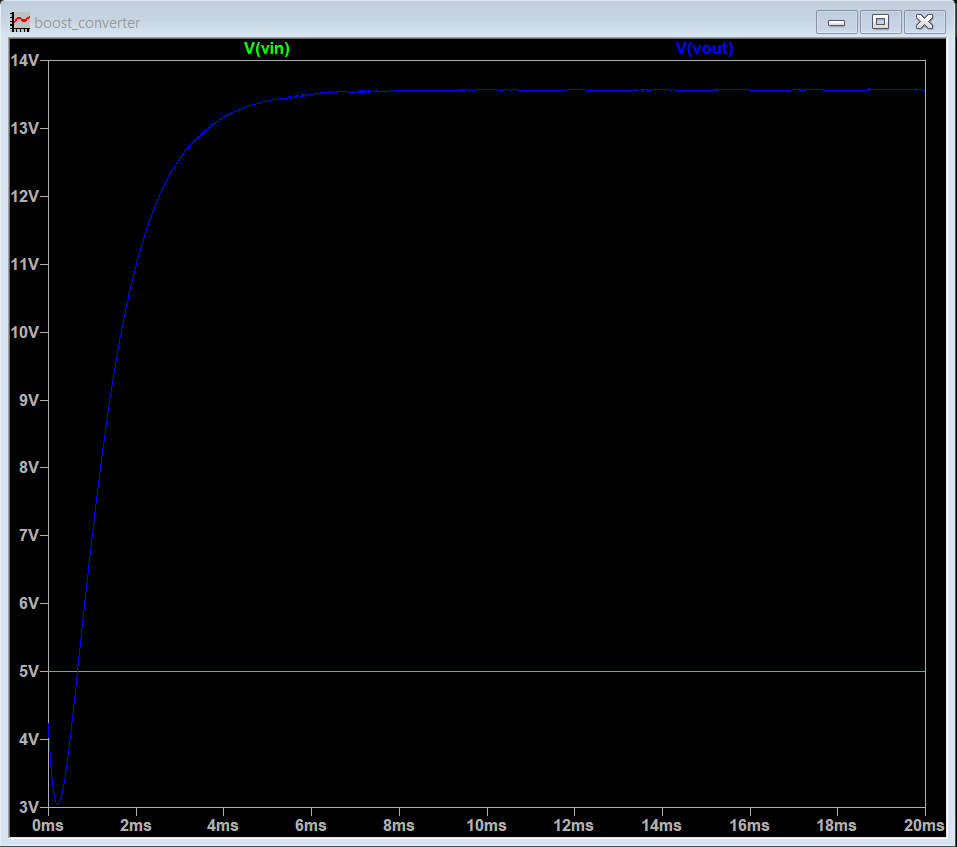
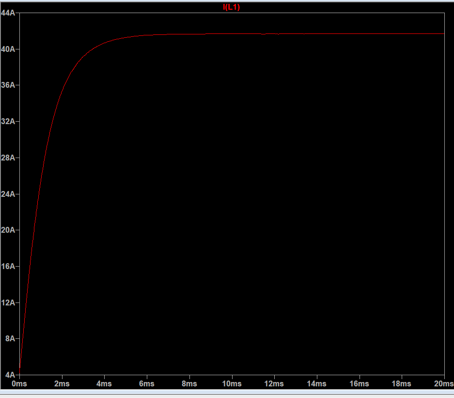
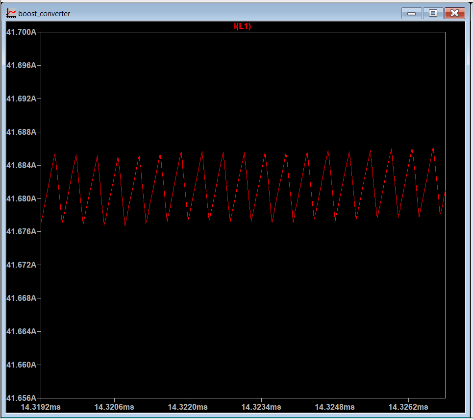

# Open-Loop DC-DC Boost Converter Simulation in LTspice

An LTspice simulation and power electronics study of an asynchronous, open-loop **DC-DC Boost (Step-Up) Converter** stepping up a **5V DC** input to **~13.55V DC** at a **2.5 MHz** switching frequency.

---

## 1. Fundamental Theory & Operating Principle

A **DC-DC Boost Converter** is a switch-mode power supply (SMPS) topology that steps up a lower DC input voltage to a higher DC output voltage using magnetic energy storage in an inductor.

### Key Concepts Used in This Project
* **Pulse Width Modulation (PWM):** Instead of dissipating excess power as heat like a linear regulator, a switching converter rapidly turns a power MOSFET ON and OFF at a fixed switching frequency ($f_s = \frac{1}{T_s}$).
* **Duty Cycle ($D$):** The fraction of one complete switching period ($T_s$) during which the MOSFET switch ($M_1$) is turned **ON**:
  $$D = \frac{T_{\text{on}}}{T_s} = \frac{T_{\text{on}}}{T_{\text{on}} + T_{\text{off}}}$$
  In this simulation, $T_s = 0.4\ \mu\text{s}$ and $D = 0.67$ ($67\%$), meaning the switch is closed for $0.268\ \mu\text{s}$ and open for $0.132\ \mu\text{s}$ every cycle.
* **Inductor Volt-Second Balance:** In steady state, the average voltage across an ideal inductor over one full switching period must equal zero. This fundamental law dictates the ideal voltage step-up ratio:
  $$V_{in} \cdot D \cdot T_s + (V_{in} - V_{out}) \cdot (1 - D) \cdot T_s = 0 \implies V_{out(\text{ideal})} = \frac{V_{in}}{1 - D}$$

### Two-Stage Switching Operation
1. **State 1 — Switch ON ($0 < t \le D T_s$):**
   * The PWM gate signal (`SW`) drives MOSFET $M_1$ ON, creating a low-resistance path to ground.
   * Input voltage $V_{in}$ is applied directly across inductor $L_1$, causing inductor current $I_{L1}$ to ramp up linearly and store energy in its magnetic field.
   * Diode $D_1$ is reverse-biased (blocking), so output capacitor $C_1$ alone supplies current to load resistor $R_1$.
2. **State 2 — Switch OFF ($D T_s < t \le T_s$):**
   * MOSFET $M_1$ turns OFF. Because inductor current cannot change instantaneously, $L_1$ reverses its polarity to oppose the drop in current.
   * The induced inductor voltage adds in series with $V_{in}$ ($V_{in} + V_L$), forward-biasing Schottky diode $D_1$.
   * Stored magnetic energy transfers to the output, recharging capacitor $C_1$ and powering load $R_1$ at a voltage higher than $V_{in}$.

---

## 2. Circuit Schematic & Component Roles

| Parameter / Component | Value / Model | Role in Circuit |
| :--- | :--- | :--- |
| **Input Voltage ($V_{in}$)** | $5\text{V DC}$ | Primary unregulated DC power source |
| **Gate Driver ($V_2$)** | `PULSE(0 5 0 1n 1n {D*Ts} {Ts})` | Generates $0\text{V}-5\text{V}$ PWM square wave at $2.5\text{ MHz}$ |
| **Switching Period ($T_s$)** | $0.4\ \mu\text{s}$ ($f_s = 2.5\text{ MHz}$) | High-frequency switching cycle |
| **Duty Cycle ($D$)** | $0.67$ ($67\%$) | Sets the energy charge-to-discharge ratio |
| **Inductor ($L_1$)** | $150\ \mu\text{H}$ | Stores magnetic energy during ON-time and boosts voltage during OFF-time |
| **MOSFET ($M_1$)** | `BSZ065N03LS` | Low-side N-channel power switch ($30\text{V}$, low $R_{DS(on)}$) |
| **Freewheeling Diode ($D_1$)** | `MBRS1100` | Schottky rectifier ($100\text{V}$, $1\text{A}$ rated) preventing capacitor back-discharge |
| **Output Capacitor ($C_1$)** | $220\ \mu\text{F}$ | Filters switching pulses into a smooth DC output voltage |
| **Load Resistor ($R_1$)** | $1\ \Omega$ | Output load drawing $\approx 13.55\text{A}$ in steady state |

---

## 3. Simulation Results & Waveform Analysis

### Input vs. Output Voltage ($V_{in}$ and $V_{out}$)

* **Transient Startup ($0\text{ ms} \rightarrow 6\text{ ms}$):** Initially, $C_1$ charges through $L_1$ and $D_1$, briefly dipping before ramping up smoothly as energy accumulates in the LC tank.
* **Steady-State Regulation:** After $\approx 6\text{ ms}$, $V_{out}$ settles cleanly at **$13.55\text{V}$** from a **$5\text{V}$** input (a $2.71\times$ voltage step-up).

### Inductor Current ($I_{L1}$) & Conduction Mode Analysis
| Full Transient Response ($0\text{ ms} - 20\text{ ms}$) | Steady-State Switching Ripple ($\Delta I_L$) |
| :---: | :---: |
|  |  |

* **Continuous Conduction Mode (CCM):** Because the average inductor current ($41.68\text{A}$) stays well above zero throughout the entire switching cycle, the converter operates firmly in CCM.
* **Triangular Ripple Waveform ($\Delta I_L$):** Zooming into steady state around $14.32\text{ ms}$ shows the classic linear charging slope (MOSFET ON) and discharging slope (MOSFET OFF). The current oscillates between **$41.677\text{A}$** and **$41.686\text{A}$** ($\Delta I_L \approx 9\text{ mA}$ peak-to-peak), demonstrating minimal current ripple due to the large $150\ \mu\text{H}$ inductance and high $2.5\text{ MHz}$ switching frequency.

---

## 4. Theoretical vs. Simulated Output Voltage (Real-World Losses)

Using the ideal boost equation with $V_{in} = 5\text{V}$ and $D = 0.67$:

$$V_{out(\text{ideal})} = \frac{5\text{V}}{1 - 0.67} \approx 15.15\text{V}$$

In LTspice, the simulated steady-state output is **$13.55\text{V}$**, resulting in a **$1.60\text{V}$ voltage drop** ($10.5\%$ deviation from ideal). Unlike textbook formulas, LTspice uses physical SPICE models that account for real power losses:

1. **Schottky Diode Forward Voltage Drop ($V_F$):** During the $(1-D)$ interval, all load current passes through `MBRS1100`. At high current levels, its nonlinear PN/Schottky junction drops **$0.6\text{V} - 0.8\text{V}$** directly from the output.
2. **Inductor DC Resistance (DCR):** LTspice automatically includes a default series resistance ($R_{\text{ser}} = 1\text{ m}\Omega$) in inductors unless overridden. At an average inductor current of **$41.68\text{A}$**, parasitic resistance causes continuous $I^2R$ conduction loss and voltage drop.
3. **MOSFET Conduction & Switching Losses:** When `BSZ065N03LS` is ON for $67\%$ of each cycle, its drain-source resistance ($R_{DS(on)}$) dissipates power proportional to $I_{L1}^2 \cdot R_{DS(on)}$. Switching at **$2.5\text{ MHz}$** also introduces gate-drive and voltage-current overlap losses during every $1\text{ ns}$ transition.
4. **Heavy Load Stress ($R_1 = 1\ \Omega$):** Delivering $13.55\text{V}$ across $1\ \Omega$ requires **$13.55\text{A}$** ($183.6\text{W}$ output power). Because input power must exceed output power ($P_{in} > P_{out}$), the input inductor carries **$\approx 41.68\text{A}$**, pushing the $1\text{A}$-rated `MBRS1100` diode far beyond its nominal operating region and magnifying conduction voltage drops.

---

## 5. How to Run This Simulation

1. Install [LTspice](https://www.analog.com/en/resources/design-tools-and-calculators/ltspice-simulator.html).
2. Clone this repository and open `boost_converter.asc`.
3. Click **Run** (`Simulate -> Run`) to execute the $20\text{ ms}$ transient analysis (`.tran 0 20m 0`).
4. Probe node `VOUT` for output voltage and hover over component `L1` to plot inductor current $I(L_1)$.
