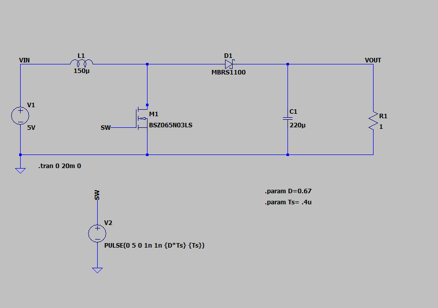

# Open-Loop DC-DC Boost Converter Simulation in LTspice

An LTspice simulation and circuit analysis of an asynchronous, open-loop **DC-DC Boost (Step-Up) Converter** stepping up a **5V DC** input to **~13.5V DC** at a **2.5 MHz** switching frequency.

---

## 1. Circuit Schematic & Parameters

### Component & Simulation Specifications
| Parameter / Component | Value / Model | Role in Circuit |
| :--- | :--- | :--- |
| **Input Voltage ($V_{in}$)** | $5\text{V DC}$ | Primary power source |
| **Switching Period ($T_s$)** | $0.4\ \mu\text{s}$ ($f_s = 2.5\text{ MHz}$) | High-frequency PWM switching |
| **Duty Cycle ($D$)** | $0.67$ ($67\%$) | Controls energy storage vs. transfer ratio |
| **Inductor ($L_1$)** | $150\ \mu\text{H}$ | Stores magnetic energy during MOSFET ON-state |
| **MOSFET ($M_1$)** | `BSZ065N03LS` | Low-side N-channel power switch ($30\text{V}$, low $R_{DS(on)}$) |
| **Freewheeling Diode ($D_1$)** | `MBRS1100` | Schottky rectifier ($100\text{V}$, $1\text{A}$ rated) |
| **Output Capacitor ($C_1$)** | $220\ \mu\text{F}$ | Filters output voltage ripple |
| **Load Resistor ($R_1$)** | $1\ \Omega$ | Heavy resistive load ($\approx 13.5\text{A}$ output current) |

---

## 2. Simulation Results

### Input vs. Output Voltage ($V_{in}$ and $V_{out}$)

* **Transient Startup ($0\text{ ms} \rightarrow 6\text{ ms}$):** The output capacitor charges smoothly through the inductor and diode, settling into steady state after roughly $6\text{ ms}$.
* **Steady-State Output:** $V_{out}$ stabilizes at **$\approx 13.55\text{V}$** from a **$5\text{V}$** input.

### Inductor Current ($I_{L1}$) & Ripple Analysis
| Full Transient Response ($0\text{ ms} - 20\text{ ms}$) | Steady-State Switching Ripple ($\Delta I_L$) |
| :---: | :---: |
|  |  |

* **Continuous Conduction Mode (CCM):** The inductor current never drops to zero during the switching cycle. It ramps up to an average steady-state value of **$\approx 41.68\text{A}$**.
* **Current Ripple ($\Delta I_L$):** Zooming in around $14.32\text{ ms}$ reveals the classic triangular inductor current waveform oscillating between **$41.677\text{A}$** and **$41.686\text{A}$** ($\Delta I_L \approx 9\text{ mA}$ peak-to-peak), confirming tightly controlled ripple due to the $150\ \mu\text{H}$ inductance and $2.5\text{ MHz}$ switching frequency.

---

## 3. Theoretical vs. Simulated Output Voltage (Why $V_{out} \neq 15.15\text{V}$)

Under ideal textbook assumptions (zero parasitic resistance, zero diode drop, instantaneous switching), the steady-state output voltage of a boost converter is:

$$V_{out(\text{ideal})} = \frac{V_{in}}{1 - D} = \frac{5\text{V}}{1 - 0.67} \approx 15.15\text{V}$$

However, LTspice models **real-world non-idealities**, resulting in an actual output of **$\approx 13.55\text{V}$** (a **$\sim 1.6\text{V}$ drop**). This loss is caused by four primary factors in the circuit:

1. **Schottky Diode Forward Voltage Drop ($V_F$):** Even though the `MBRS1100` is a Schottky diode, conducting high peak currents causes a forward voltage drop of **$0.6\text{V} - 0.8\text{V}$** every time the diode conducts during the $(1-D)$ interval.
2. **Inductor DC Resistance (DCR):** LTspice automatically assigns a default series resistance ($R_{\text{ser}} = 1\text{ m}\Omega$) to inductors unless explicitly set to zero. At an average inductor current of **$41.68\text{A}$**, even milliohms of resistance generate noticeable $I^2R$ conduction losses.
3. **MOSFET Conduction & Switching Losses:** During the $67\%$ duty cycle when `BSZ065N03LS` is ON, its drain-source on-resistance ($R_{DS(on)}$) drops voltage proportional to the $41.68\text{A}$ inductor current. Additionally, switching at **$2.5\text{ MHz}$** introduces gate-charge and overlap losses during every rise/fall transition.
4. **Component Over-Stress ($1\ \Omega$ Heavy Load):** A $1\ \Omega$ load at $13.55\text{V}$ draws **$13.55\text{A}$** ($\approx 183\text{W}$), which pushes the `MBRS1100` ($1\text{A}$ average rating) well beyond its intended operating curve, exaggerating its forward voltage drop in the SPICE model.

---

## 4. How to Run This Simulation

1. Download and install [LTspice](https://www.analog.com/en/resources/design-tools-and-calculators/ltspice-simulator.html).
2. Clone this repository or download `boost_converter.asc`.
3. Open `boost_converter.asc` in LTspice and click **Run** (the running person icon).
4. Click on the `VOUT` node and hover over `L1` (current probe) to reproduce the voltage and current plots.